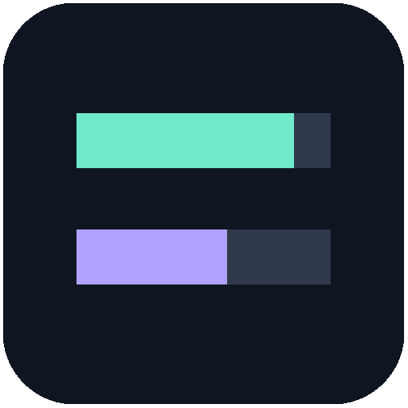
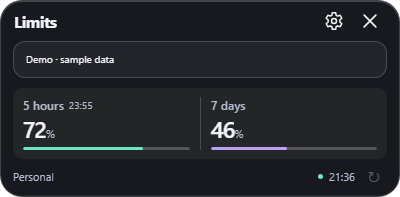
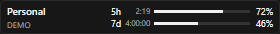
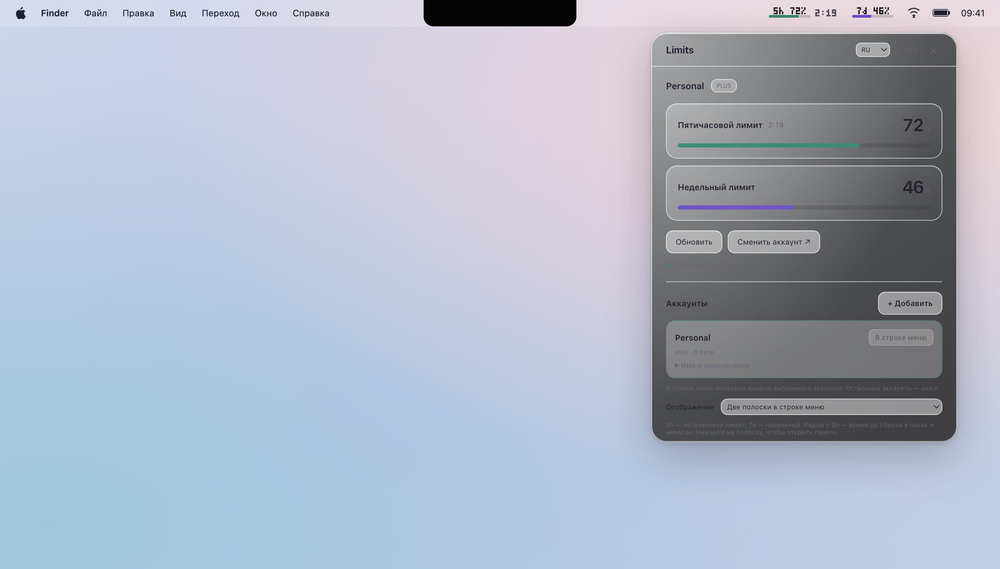
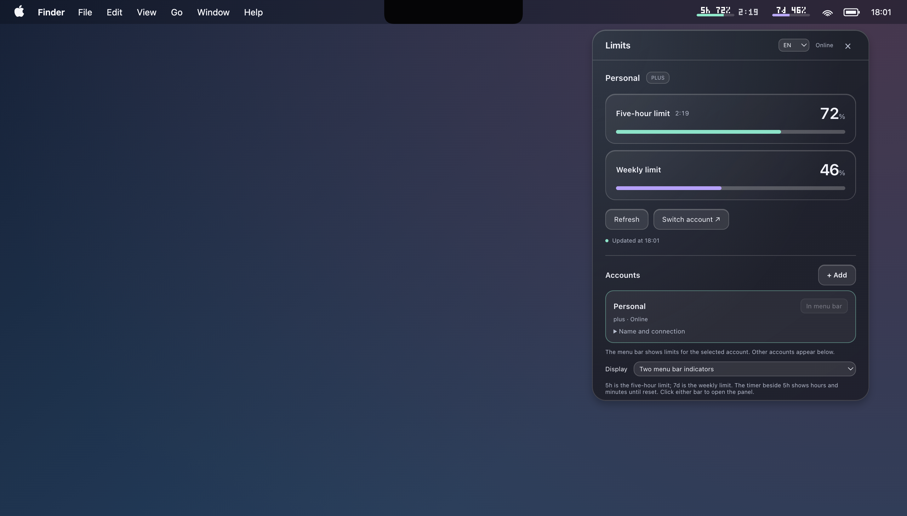
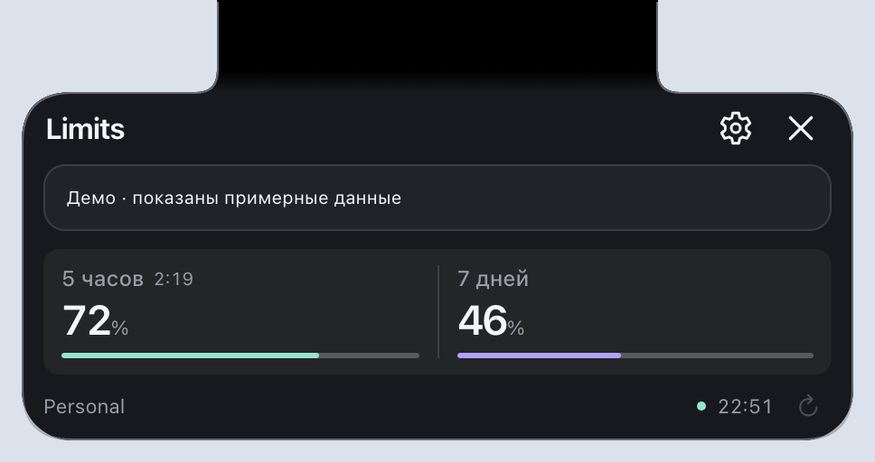
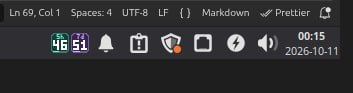
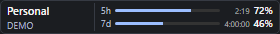
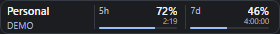
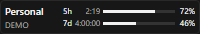

  

<h1 align="center">Limits</h1>

<strong>Keep your Codex limits in sight.</strong> 
Remaining usage, reset timers, and multiple accounts — right in your taskbar, menu bar, or system tray.

  
  

  <a href="https://github.com/PyatkovVK/limits/releases"><strong>Download from Releases</strong></a> ·
  <a href="#screenshots">Screenshots</a> ·
  <a href="https://github.com/PyatkovVK/limits/issues/new/choose">Report a bug</a> ·
  <a href="README.ru.md">Русский</a>

**Limits** is a desktop app for monitoring **Codex usage limits included in your ChatGPT subscription**. Check your remaining five-hour and weekly allowances before starting your next task, without opening Codex.

  
    
  

*Windows and macOS screenshots use demo data. The macOS desktop background and menu bar are recreated for publication.*

## Features

- **Two usage windows:** remaining five-hour and weekly allowances, with reset information.
- **Multiple accounts:** subscriptions connected in Limits and current local Codex / VS Code profiles, with separate usage data, local names, filters, and a selected account for your compact indicators.
- **GLM Coding Plan:** track remaining 5-hour and weekly allowances from Z.ai, with reset times when available.
- **DeepSeek balance:** connect an API key from Settings → Subscriptions, then monitor total, granted and topped-up funds in USD or CNY with independent refreshes.
- **Automatic refresh:** polling about one minute after each completed request, refresh after waking from sleep, and a manual refresh button.
- **Clear status:** low allowances are highlighted; unavailable values show a dash, and stale data is dimmed.
- **Platform-specific controls:** Windows taskbar widget or tray icons, macOS menu bar or compatible MacBook notch, and Linux tray icons.
- **Application updates:** offers new versions, downloads on request, verifies packages, and installs with restart in supported installed builds on Windows, macOS, and Linux.
- **Launch at login:** enable autostart in Settings for supported installed builds on each platform.
- **English and Russian UI:** language and display preferences persist across launches.

## Download and install

1. Open [GitHub Releases](https://github.com/PyatkovVK/limits/releases) and expand **Assets** for the release you want.
2. Download a package for your OS and processor using the table below.
3. Launch Limits. If you are not already signed in to Codex, choose **Sign in with ChatGPT** and complete sign-in in your browser.

Ready-to-use packages include Electron and do not require Node.js.

| System | Choose in Assets | Codex requirement |
| --- | --- | --- |
| Windows 10 / 11, x64 | `Limits-Setup-*.exe` to install; `Limits-*-portable.exe` without installation | Connection component included |
| macOS, Apple Silicon | `Limits-*-arm64.dmg` or `Limits-*-arm64.zip` | Connection component included |
| macOS, Intel | `Limits-*-x64.dmg` or `Limits-*-x64.zip` | Connection component included |
| Linux, x64 | `Limits-*-x86_64.AppImage` or `Limits-*-amd64.deb` | Connection component included |

**Windows:** run the per-user installer or launch the portable EXE. No separate Codex installation is needed. Tray icons may initially appear under the arrow near the clock; drag them into the visible area if desired.

**macOS:** open the DMG and drag Limits into **Applications**, or extract the ZIP and move the app there. If macOS says the developer cannot be verified, follow the [first-launch guide](#macos-first-launch) below. The connection component is included; Codex does not need to be installed or kept open.

**Linux:** make the downloaded AppImage executable in your file manager's permissions and open it. Alternatively, install the DEB on a compatible distribution. The connection component is included; a separate Codex installation is not required. Source builds can use an installed CLI; see [configuration](docs/development.md#configuration).

**Platform notes:** Linux Mint 22.2 Zara, XFCE 4.18, X11, x64 is the tested Linux environment. Other desktops need testing; tray behavior varies. Linux autostart is not implemented.

### macOS: allow the first launch

I maintain Limits independently and currently cannot afford the [Apple Developer Program membership](https://developer.apple.com/programs/) ($99 per year). The current macOS downloads are not signed with a Developer ID certificate or notarized by Apple, so macOS may block the first launch with an unidentified-developer warning.

If you downloaded Limits from this project's [GitHub Releases](https://github.com/PyatkovVK/limits/releases) and trust the app, allow it through System Settings:

1. Open **Limits** from **Applications**. If macOS blocks it, dismiss the warning with **Done** or **Cancel**, keeping the app.
2. Open **Apple menu → System Settings → Privacy & Security**.
3. Scroll down to **Security**. Find the message about Limits being blocked and click **Open Anyway**. This option appears after an attempt to open the app.
4. Authenticate if macOS asks, then click **Open** in the confirmation dialog.

macOS remembers this exception for the app, so subsequent launches can use a normal double-click. See [Apple's first-launch instructions](https://support.apple.com/en-us/102445).

## Screenshots

### macOS — menu bar and notch

Two indicators, **5h** and **7d**, show remaining usage, with a reset timer beside **5h**. The panel supports light and dark themes, Retina, and native background blur. On a MacBook with a physical notch, hover for a compact view or click for the full panel. After installing the app, enable **Settings → General → Launch at login** to start in the background at login. This also works with local ad hoc signed builds; disabling the option removes the startup entry.

**Settings → General → Display → Around the notch** selects a black panel with curved joins into the notch and persistent **5h** / **7d** values on either side. Low-allowance warnings, enabled Codex Resets alerts, and update announcements expand inside this panel. Messages queue, dismiss automatically after ten seconds when the pointer is away, and can be closed with × or Esc. Both notch modes require a physical MacBook notch.

The bottom of the collapsed panel aligns with the physical notch. The panel widens again when space opens up in the menu bar. As neighbouring items leave less room, the panel narrows and scales the 5h and 7d labels together with their percentages. The narrowest layout uses two lines. If the wings are too narrow for the values, hover over the notch to see them. Unavailable menu metadata does not hide the side values, and a temporary probe failure keeps the last measured layout. The collapsed panel and hover preview always share the same width and side edges. The collapsed notch stays black; a selected background appears inside the expanded details panel. Areas outside the notch chrome remain transparent and pass clicks through. This does not request additional macOS permissions.

The side panel adapts to additional metrics. Values that do not fit move into a **+N** control, which opens the complete list in the scrollable details panel.

Dark theme and MacBook notch

The notch mode uses the compatible MacBook screen, including when an external display is attached. It is hidden on Macs without a physical notch. Esc or loss of focus collapses the panel. Reduced motion and transparency settings are respected.

### Linux — system tray

The turquoise **5h** and purple **7d** indicators show remaining usage with numbers and short bars. Tooltips expose account details and reset information where supported by the desktop environment. The details panel adapts to its contents and scrolls for long account lists.

Enable **Settings → General → Launch at login** to start an installed DEB or AppImage automatically, using your saved tray style without opening details.

In **Settings → General → Display**, Linux offers two choices: classic percentage tray icons and quota-period labels with remaining-usage bars. Classic remains the default, and your selection is saved. Clicking either quota icon again closes details. Previously saved desktop-widget selections switch to tray mode automatically.

### Windows — taskbar or tray

If the details panel is open, it follows the widget as you drag it along the taskbar and stays within the screen. Moving the widget keeps a dismissed panel closed.

The widget and details panel are shown above. Switch between a taskbar widget and two tray icons in **Settings → General → Display**. Drag any part of the widget, including labels, bars and percentages, to move it; a regular click on the limits opens details. Choose **240 / 280 / 320 / 400 px** widths in **Settings → Panel settings**. Drag the details title bar to keep a preferred position across openings and restarts. The details panel fits its content and resizes when Settings opens or closes. The widget hides for full-screen apps and recovers after the taskbar restarts. At **10% or less**, a Windows notification appears once per usage window. Autostart is available for the installed version.

When the area beside the tray is crowded, the widget automatically shrinks to fit, down to 200 px, or moves to a free area on the left without covering taskbar buttons. If neither side has room, it stays visible just above the taskbar. The preferred width and taskbar placement return when more space becomes available.

In **Settings → Panel settings → Widget reset times**, choose **Date and time** (the default), **Time until reset**, or **Do not show**. The countdown shows hours and minutes for the 5-hour limit and includes days for the weekly limit. Limits saves your choice.

Choose a layout in **Settings → Panel settings → Widget style**. **Classic** is the default. **Rows** places the reset time after each bar, and **Cells** puts the two limits side by side.

- **Classic**

  
- **Rows**

  
- **Cells**

  

## Everyday use

- Click the widget or an indicator to open details, view accounts, and refresh usage.
- Open **Settings → Subscriptions → + Add** and choose a provider. Expand a profile to see its usage and choose **Use in panel** to show it in the compact display.
- Open **Settings → General** to change the language, display mode or launch at login. The tray menu also opens Settings.
- Closing the details panel keeps Limits running. Choose **Quit application** to exit; quit the old version before launching an update.
- Drag the details title bar to keep a custom position across openings and restarts. The panel stays inside the available screen after monitor changes.

## Application updates

Limits checks stable releases on GitHub in the background at startup and every six hours. After waking, it checks if the scheduled time has passed. Open **Settings → Updates → Check** for a manual check, the installed version and the last check result.

When a new version is found, choose **Download update** in the offer or Settings to start downloading. **Later** postpones the offer without downloading. After verification, choose **Update** in Settings or **Install and restart** in the offer.

**macOS:** installed copies in `/Applications` or `~/Applications` download the matching Apple Silicon or Intel ZIP on request from stable GitHub Releases published by Actions. Limits verifies the published SHA-256 checksum, app identity, version, architecture and code signature before offering **Install and restart**. Installation preserves the previous app if replacement or launching fails. The app folder must be writable by your user; move the app out of the DMG before updating. No GitHub account or token is needed. Builds kept only in Actions artifacts, including demo builds, are not update releases.

**Windows:** installed and portable x64 builds download their matching update on request from Actions-published stable GitHub Releases. Packages are checked against SHA256SUMS.txt and product/version metadata; signed installations also require a valid matching publisher. Choose **Install and restart** when ready. Portable updates replace the original executable and keep a backup until relaunch. Accounts and settings are retained. The app reports download, verification and installation errors and allows retries.

**Linux:** Linux also downloads stable update packages on request and verifies SHA-256 before offering Install and restart. Writable AppImages update in place; installed DEBs use dpkg/pkexec and ask for system authorization only when installing. Accounts and settings remain in place. See [platform installation details](docs/in-app-updates.md). Source/unpacked builds retain manual installation.

Demo mode simulates update checks without contacting GitHub or opening a browser; **Demo result** in Updates lets you preview current, available and failed states.

## Data and sign-in

For Codex, Limits starts a local **Codex App Server** process and reads account and usage information. It does not create chats or send model prompts. ChatGPT sign-in is required for Codex subscription limits; API-key authentication does not expose those allowances. Limits monitors Codex allowances, rather than all ChatGPT model message limits.

**DeepSeek:** open **Settings → Subscriptions → + Add** and choose DeepSeek. Limits opens the API-key page in your browser. Sign in, create a key, return to Limits and paste it into **Connect DeepSeek**. The profile is added after a successful balance check; cancellation leaves no empty profile. Keys are encrypted on this device using the OS credential storage through Electron; connecting fails if secure storage is unavailable. Use the trash button to disconnect the profile and delete its saved key from the device. The key remains valid in DeepSeek. To use a different key, disconnect and add DeepSeek again. Balances refresh about one minute after each completed request, independently from Codex. Different currencies are kept separate. Account-wide token or spending history is not included.

**GLM Coding Plan (Z.ai)** is available in Settings → Subscriptions. Open **+ Add**, choose **GLM Coding Plan (Z.ai)** and paste a key from **Personal Coding Plan** in the Z.ai console. After validating the key, Limits stores it encrypted on this device and checks the 5-hour and weekly allowances independently about once per minute. The panel shows a reset time when Z.ai reports one. Use **Manage → Replace API key** to update the key or disconnect the profile to remove its local copy.

**macOS:** Settings → Subscriptions distinguishes **Connected in Limits** from **In Codex / VS Code**; **All** shows both. The current local Codex account is tracked from `CODEX_HOME` (normally `~/.codex`) and is reloaded on each poll. Sign in or out of that profile in Codex / VS Code. Connecting from Limits creates an isolated account and does not switch the external profile. Extra local `CODEX_HOME` folders are not tracked. These are locally saved sign-ins, not proof of which account an individual running chat uses; remote VS Code and memory-only sessions are not discovered. Details: [macOS subscriptions](docs/macos-accounts.md).

On Windows and Linux, choose All, Connected in Limits, or In Codex / VS Code to view subscriptions. The default local Codex home is tracked automatically and reloads sign-in changes on polling; sign in or out in Codex / VS Code. Extra CODEX_HOME folders are not tracked. Codex accounts added in Limits use separate storage managed by Codex. The app does not read OAuth tokens into its UI.

Limits has no app-level analytics or telemetry integration in its source. Codex connects to OpenAI services for sign-in and usage data; its behavior is managed by Codex. See [data storage and privacy](docs/privacy.md).

**Limits is an independent community project and is not affiliated with or endorsed by OpenAI.**

## Backgrounds

Use **Background** to choose the platform default, a solid color, or a local PNG/JPG image. The live preview shows the selected background in the current panel style. The background applies to the details panel and Windows widget. Images are copied into the app profile and remain available if the original file is moved.

## Help and contribute

[Report a bug or suggest a feature](https://github.com/PyatkovVK/limits/issues/new/choose). Include your OS, app version, and steps to reproduce; hide personal information in screenshots.

Translations, documentation improvements, and platform testing are welcome. Start with [CONTRIBUTING.md](CONTRIBUTING.md), the [development guide](docs/development.md), and issues labeled [good first issue](https://github.com/PyatkovVK/limits/labels/good%20first%20issue). Please follow the [code of conduct](CODE_OF_CONDUCT.md).

For additional AI integrations, see the [shared controller guide](docs/ai-controllers.md).

For local testing, choose the [suite for the code you changed](docs/development.md#checks).

Use `npm run doctor -- codex`, `npm run doctor -- deepseek`, or `npm run doctor -- zai` to check a provider connection. [Provider diagnostics](docs/development.md#provider-diagnostics)

See [CHANGELOG.md](CHANGELOG.md) for release features. Limits uses the [MIT license](LICENSE); bundled dependencies have their own [third-party notices](THIRD-PARTY-NOTICES.md).

## Roadmap

These are ideas for future work, not current features:

- Claude Code integration, subject to availability of a suitable usage data source.
- Configurable low-usage and approaching-reset notifications.
- Try to rewrite project to Rust.

Tell us which feature would help you in a [feature request](https://github.com/PyatkovVK/limits/issues/new/choose).
