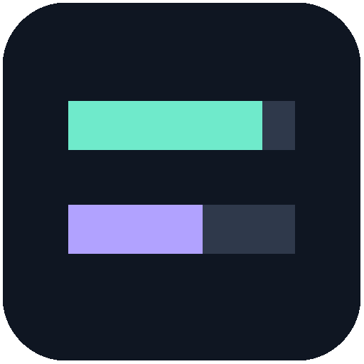
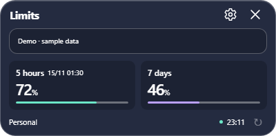
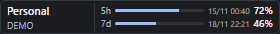
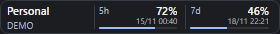
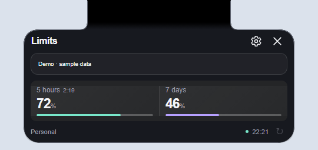
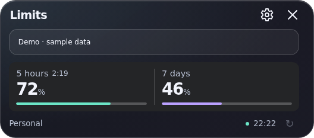

<p align="center">
  
</p>

<h1 align="center">Limits</h1>

<p align="center">See your AI usage limits, reset times, and API balances in your taskbar, menu bar, or system tray.</p>

<p align="center">
  <a href="https://github.com/PyatkovVK/limits/releases/latest"><strong>Download</strong></a> ·
  <a href="#display-by-platform">Display by platform</a> ·
  <a href="#build-from-source">Build from source</a> ·
  <a href="#help">Help</a>
</p>

<p align="center">
  
  <br><br>
  
</p>

## Features

- **Usage at a glance.** See how much quota you have left and when it resets. Limits refreshes in the background.
- **Multiple subscriptions.** Keep work and personal profiles together, give them local names, and choose which one appears in the compact display.
- **Customizable display.** Pick a layout, background, and the reset-time format supported by your platform.

## Supported integrations

Open **Settings → Subscriptions → + Add** and select a service. Availability depends on your installed version. [Release notes](CHANGELOG.md)

| Service | What Limits shows | How to connect |
| --- | --- | --- |
| OpenAI Codex | Five-hour and weekly ChatGPT subscription quotas | Sign in with ChatGPT or use your existing local Codex / VS Code sign-in |
| Claude Code | Five-hour and weekly quotas, when reported | Follow the in-app instructions to add the Claude Code status line |
| GLM Coding Plan (Z.ai) | Five-hour and weekly quotas | Paste a Personal Coding Plan API key |
| Kimi Code | Five-hour quota and weekly quota where available | Paste a Kimi Code API key |
| DeepSeek | API balance, including granted and topped-up funds | Paste a DeepSeek API key |

## Privacy

Your profiles, settings, and saved credentials stay on your computer. Limits encrypts saved API keys and has no cloud storage or telemetry. Limits does not share your data with unrelated third parties. Sign-in and usage requests go directly to the connected provider. Claude Code quotas are read from a local file, and GitHub update checks are anonymous. [Data storage and privacy](docs/privacy.md)

## Download and install

Open the [latest GitHub release](https://github.com/PyatkovVK/limits/releases/latest) and choose a file under **Assets**. Release packages include the Codex connection component.

| Platform | Download and open |
| --- | --- |
| Windows x64 | Run `Limits-Setup-*.exe` to install or `Limits-*-portable.exe` to run directly. |
| macOS | Choose the `arm64` DMG for Apple Silicon or the `x64` DMG for Intel. Open it and drag Limits to **Applications**. |
| Linux x64 | Mark the `.AppImage` as executable and run it, or install the `.deb` on a compatible distribution. |

### First-launch warnings

I maintain Limits independently and haven't bothered with the paperwork for Apple Developer ID or a Windows code-signing certificate.

- **Windows** may show a SmartScreen warning about an unrecognized app or publisher when you open an unsigned build. [Microsoft SmartScreen documentation](https://learn.microsoft.com/en-us/windows/security/operating-system-security/virus-and-threat-protection/microsoft-defender-smartscreen/)
- **macOS** may block a build distributed without Apple notarization. If you trust the download, try opening Limits once, then go to **System Settings → Privacy & Security → Open Anyway** and confirm. [Apple's first-launch instructions](https://support.apple.com/en-us/102445)

## Build from source

Install Git and Node.js 22.12 or newer with npm. Run the instructions for the OS you want to build on. The packages land in `release/`.

### Windows

On Windows x64, install .NET Framework 4.x if the C# compiler is missing. In PowerShell, run the following to build an installer and a portable EXE.

```powershell
git clone https://github.com/PyatkovVK/limits.git
cd limits
npm.cmd install
npm.cmd run build:win:x64
```

### macOS

Install Xcode Command Line Tools with `xcode-select --install` if needed. In Terminal, build a DMG and ZIP for your Mac's architecture.

```sh
git clone https://github.com/PyatkovVK/limits.git
cd limits
npm install
npm run build:mac
```

To select an architecture explicitly, use `npm run build:mac:arm64` for Apple Silicon or `npm run build:mac:x64` for Intel.

### Linux

On Linux x64, open a terminal and build the AppImage and DEB.

```sh
git clone https://github.com/PyatkovVK/limits.git
cd limits
npm install
npm run build:linux:x64
```

On an ARM64 Linux machine, use `npm run build:linux:arm64`.

## Display by platform

### Windows

Keep Limits in a draggable taskbar widget or switch to icons in the system tray.



### macOS

Use menu bar indicators or display quotas around the notch on compatible MacBooks. Click the notch to open the full panel.




### Linux

Choose Classic, Digits, or Rings in the system tray. On XFCE, Genmon adds a wide Line or Shelf to the panel. Click an indicator to open the details panel. See the [Linux display setup](src/linux_feature/README.md).




## Customize the display

- Under **Settings → Background**, choose the default background, a solid color, or a local PNG or JPEG. Switch between **Standard** and **Two columns** where supported.
- On Windows, **Panel settings** lets you change the widget width, choose **Classic**, **Rows**, or **Cells**, and show reset times as dates, countdowns, or hide them.
- Under **Settings → Subscriptions**, choose **Use in panel** to pick the profile whose quotas or balance appear in the compact display.

## Updates

When Limits finds a new stable release, it shows an update message. On supported builds, choose **Download update**, then **Install and restart** after verification. You can also check manually under **Settings → Updates → Check**. [Update details](docs/in-app-updates.md)

## Help

- **Getting started.** Click the widget, menu bar indicator, or tray icon to open the panel. Go to **Settings → Subscriptions** to connect a service or check its status.
- **Found a bug?** Include your OS, Limits version, and steps to reproduce. Crop or hide account details in screenshots. [Report a bug](https://github.com/PyatkovVK/limits/issues/new/choose)
- **Working on Limits?** See the [development guide](docs/development.md) for demo mode, testing, and connection diagnostics. [Contributing guide](CONTRIBUTING.md)

Limits is an independent community project released under the [MIT license](LICENSE). See the [third-party notices](THIRD-PARTY-NOTICES.md) for bundled dependencies.

## Roadmap

- Explore a rewrite in Rust.

[Suggest a feature](https://github.com/PyatkovVK/limits/issues/new/choose).
