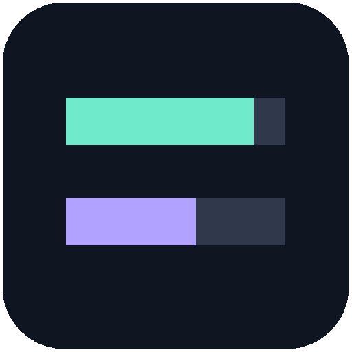
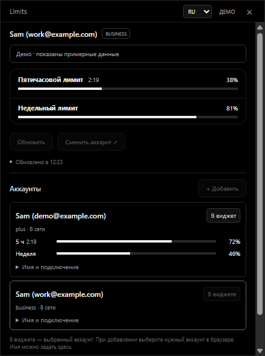
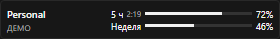
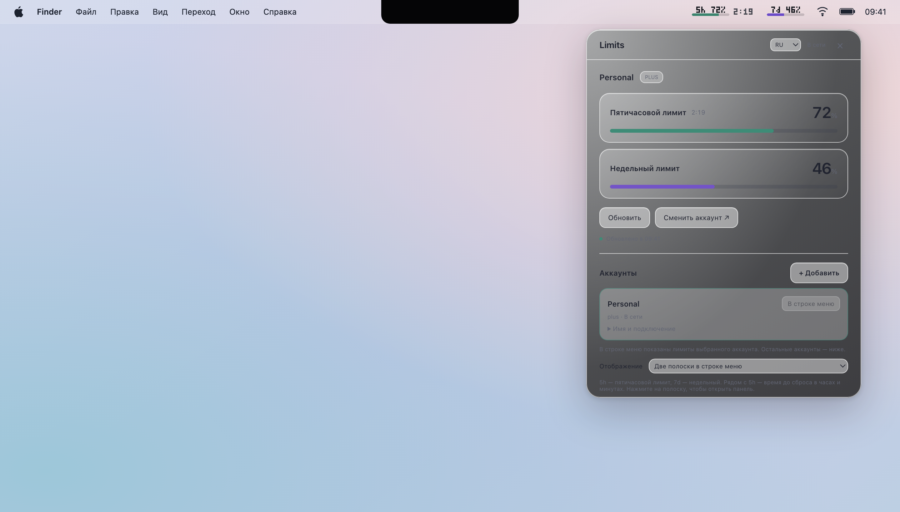
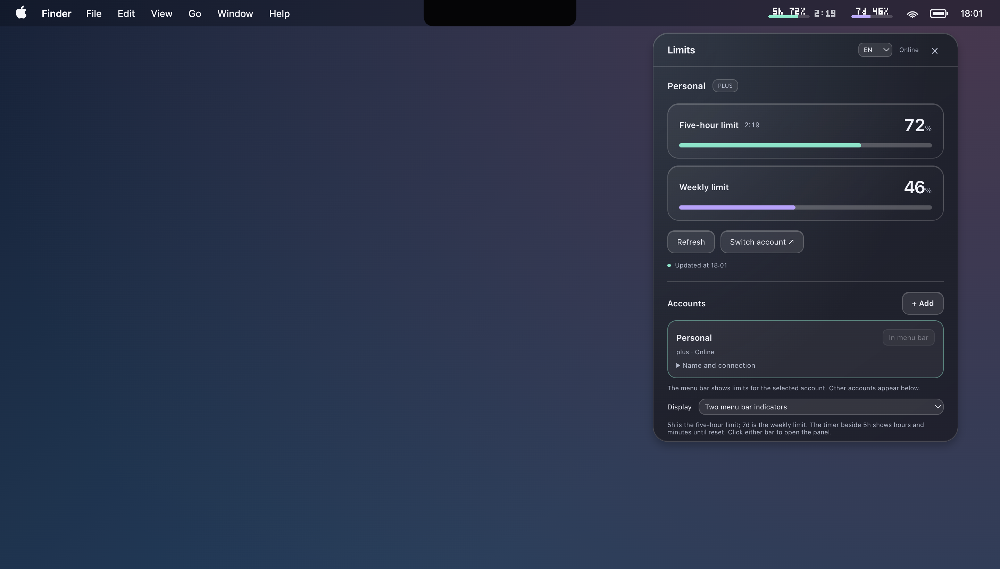
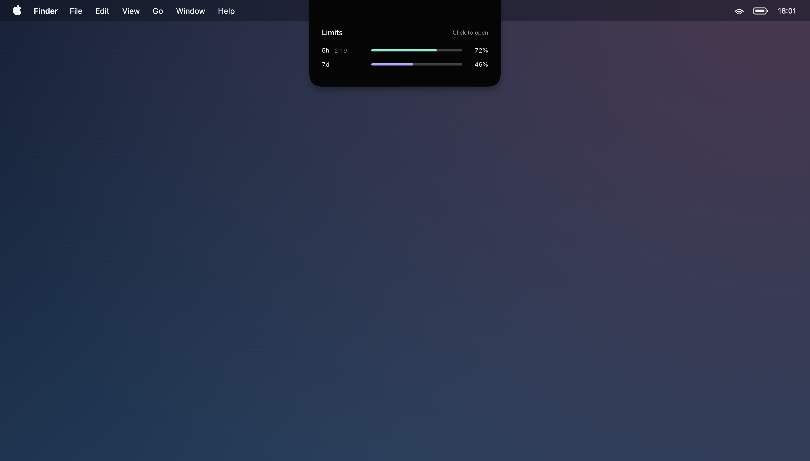
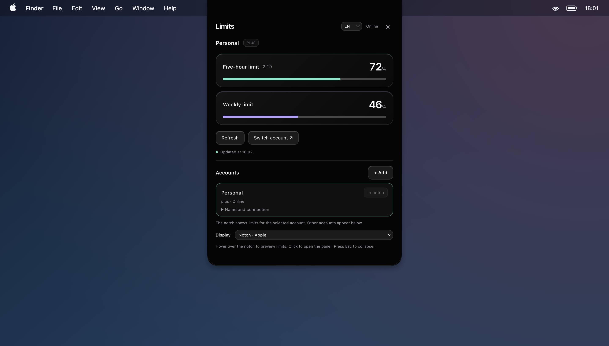
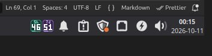
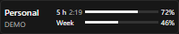

  

<h1 align="center">Limits</h1>

<strong>Лимиты Codex всегда перед глазами.</strong> 
Остаток лимитов, время сброса и несколько аккаунтов — в панели задач, строке меню или системном трее.

  
  

  <a href="https://github.com/PyatkovVK/limits/releases"><strong>Скачать из Releases</strong></a> ·
  <a href="#screenshots">Скриншоты</a> ·
  <a href="https://github.com/PyatkovVK/limits/issues/new/choose">Сообщить об ошибке</a> ·
  <a href="README.md">English</a>

**Limits** — настольное приложение для мониторинга **лимитов Codex по подписке ChatGPT**. Оцените остаток пятичасового и недельного лимитов перед следующей задачей, не открывая Codex.

  
    
  

*Снимки Windows и macOS используют демонстрационные данные. Фон рабочего стола и строка меню macOS воссозданы для публикации.*

## Возможности

- **Два окна лимитов:** остаток пятичасового и недельного лимитов, информация о сбросе.
- **Несколько аккаунтов:** независимые лимиты, локальные имена и выбор аккаунта для компактных индикаторов.
- **Автоматическое обновление:** опрос примерно через 30 секунд после завершения запроса, обновление после выхода из сна и ручная кнопка.
- **Понятное состояние:** низкий остаток выделяется цветом, неизвестные значения показаны прочерком, устаревшие данные приглушены.
- **Отображение под каждую ОС:** виджет или трей Windows, строка меню или чёлка совместимого MacBook, значки трея Linux.
- **Русский и английский интерфейсы:** язык и настройки отображения сохраняются между запусками.

## Скачать и установить

1. Откройте [GitHub Releases](https://github.com/PyatkovVK/limits/releases) и раскройте **Assets** нужного релиза.
2. Скачайте пакет для своей ОС и процессора по таблице ниже.
3. Запустите Limits. Если входа в Codex ещё нет, нажмите **«Войти через ChatGPT»** и завершите авторизацию в браузере.

Готовые пакеты содержат Electron и не требуют установки Node.js.

| Система | Что выбрать в Assets | Требование к Codex |
| --- | --- | --- |
| Windows 10 / 11, x64 | `Limits-Setup-*.exe` для установки; `Limits-*-portable.exe` без установки | Компонент подключения включён |
| macOS, Apple Silicon | `Limits-*-arm64.dmg` или `Limits-*-arm64.zip` | Компонент подключения включён |
| macOS, Intel | `Limits-*-x64.dmg` или `Limits-*-x64.zip` | Компонент подключения включён |
| Linux, x64 | `Limits-*-x86_64.AppImage` или `Limits-*-amd64.deb` | Компонент подключения включён |

**Windows:** запустите установщик для текущего пользователя или откройте portable EXE. Отдельная установка Codex не нужна. Значки трея могут появиться под стрелкой возле часов — при желании перетащите их в видимую область.

**macOS:** откройте DMG и перенесите Limits в **Applications**, либо распакуйте ZIP и переместите приложение туда. Если macOS пишет, что разработчика нельзя проверить, воспользуйтесь [инструкцией первого запуска](#macos-first-launch) ниже. Компонент подключения включён: устанавливать Codex и держать его открытым не нужно.

**Linux:** в свойствах скачанного AppImage разрешите выполнение файла и откройте его. Либо установите DEB на совместимом дистрибутиве. Компонент подключения включён: отдельная установка Codex не нужна. При запуске из исходников можно использовать установленный CLI; см. [настройку](docs/development.md#configuration).

**Особенности платформ:** проверенное окружение Linux — Linux Mint 22.2 Zara, XFCE 4.18, X11, x64. Другие рабочие столы требуют проверки; поведение трея зависит от окружения. Автозапуск Linux пока не реализован. Windows-пакеты не подписаны; локальные сборки macOS используют подпись ad hoc, Developer ID и нотариализация настраиваются отдельно.

### macOS: разрешить первый запуск

Я развиваю Limits самостоятельно и пока не могу позволить себе участие в [Apple Developer Program](https://developer.apple.com/programs/) за $99 в год. Поэтому текущие сборки macOS не подписаны сертификатом Developer ID и не прошли нотариализацию Apple: при первом запуске система может показать предупреждение о неподтверждённом разработчике и заблокировать приложение.

Если вы скачали Limits из [GitHub Releases этого проекта](https://github.com/PyatkovVK/limits/releases) и доверяете приложению, разрешите запуск через системные настройки:

1. Откройте **Limits** из папки **«Программы» (Applications)**. Если macOS заблокирует запуск, закройте предупреждение кнопкой **«Готово»** или **«Отмена»**, сохранив приложение.
2. Откройте **меню Apple → «Системные настройки» → «Конфиденциальность и безопасность»**.
3. Прокрутите до раздела **«Безопасность»**. Найдите сообщение о блокировке Limits и нажмите **«Всё равно открыть» (Open Anyway)**. Эта кнопка появляется после попытки запустить приложение.
4. Подтвердите действие, если macOS запросит авторизацию, затем нажмите **«Открыть»** в появившемся окне.

macOS запомнит исключение для приложения, и дальше его можно будет открывать обычным двойным щелчком. Подробнее — в [инструкции Apple](https://support.apple.com/ru-ru/102445).

## Скриншоты

### macOS — строка меню и чёлка

Два индикатора **5h** и **7d** показывают остаток, рядом с **5h** — время до сброса. Панель поддерживает светлую и тёмную темы, Retina и нативное размытие. На MacBook с физической чёлкой наведение раскрывает краткий просмотр, нажатие — полную панель. Для готового приложения доступен автозапуск.

Тёмная тема и режим чёлки MacBook

Режим чёлки использует совместимый экран MacBook, в том числе при подключённом внешнем мониторе. На Mac без физической чёлки режим скрыт. Esc или уход фокуса сворачивают панель. Учитываются настройки уменьшения движения и прозрачности.

### Linux — системный трей

Бирюзовый **5h** и фиолетовый **7d** показывают остаток цифрами и короткими полосами. Данные аккаунта и информация о сбросе доступны в подсказках, если их поддерживает рабочий стол. Окно подробностей подстраивается под содержимое и прокручивается при длинном списке аккаунтов.

В **«Настройки → Значки в трее»** можно выбрать подписи периодов с полосами остатка или прежние значки с процентами. Прежний вид остаётся вариантом по умолчанию, а выбор сохраняется.

### Windows — панель задач или трей

Если окно деталей открыто, оно следует за виджетом при перетаскивании вдоль панели задач и остаётся в пределах экрана. Перемещение виджета не открывает закрытое окно деталей.

Виджет и панель аккаунтов показаны выше. В **«Настройках»** можно переключиться между виджетом и двумя значками трея. Перетаскивайте виджет за любую часть, включая подписи, полосы и проценты; обычный клик по лимитам открывает подробности. Ширина **240 / 280 / 320 / 400 px** выбирается в **«Настройки → Виджет Windows»**. Перетащите окно деталей за заголовок: выбранное положение сохраняется при повторном открытии и перезапуске. Окно деталей подстраивается под содержимое и меняет высоту при открытии и закрытии настроек. Время сброса показывается по местным часам, с датой для другого дня; полная дата доступна при наведении. Виджет скрывается при полноэкранных приложениях и восстанавливается после перезапуска панели задач. При остатке **не более 10%** уведомление Windows появляется один раз за окно лимита. Для установленной версии доступен автозапуск.

Если рядом с треем мало места, виджет автоматически сжимается до подходящей ширины, минимум 200 px, либо переходит в свободную область слева, не перекрывая кнопки панели задач. Когда место освобождается, выбранная ширина восстанавливается.

## Как пользоваться

- Нажмите на виджет или индикатор, чтобы открыть подробности, посмотреть аккаунты и обновить данные.
- Добавьте аккаунт через **«Аккаунты» → «+ Добавить»**, завершите вход в браузере, задайте локальное имя и выберите **«В виджет»** для компактного отображения.
- Откройте **«Настройки»**, чтобы изменить язык, режим отображения, аккаунты, размер виджета или доступный автозапуск. Настройки можно открыть и из меню трея.
- Закрытие окна подробностей оставляет Limits работающим. Для выхода выберите **«Выйти из приложения»**. Перед запуском обновления завершите старую версию.

## Обновления приложения

Limits проверяет стабильные релизы GitHub в фоне при запуске и каждые шесть часов. После выхода из сна проверка выполняется, если назначенное время уже прошло. Откройте **«Настройки» → «Обновления» → «Проверить обновления»**, чтобы запустить проверку вручную, посмотреть установленную версию и результат последней проверки.

**macOS (1.5):** установленная копия в `/Applications` или `~/Applications` автоматически скачивает ZIP для Apple Silicon или Intel из стабильного GitHub Release, опубликованного Actions. Limits проверяет опубликованную SHA-256, идентификатор приложения, версию, архитектуру и подпись, затем предлагает **«Установить и перезапустить»**. При ошибке замены или запуска сохраняется прежнее приложение. Нужны права записи в папку приложения; перед обновлением перенесите Limits из DMG в «Программы». Учётка и токен GitHub не нужны. Сборки только в артефактах Actions, включая демосборки, не являются релизами для обновления.

**Windows, Linux и запуск из исходников:** выберите **«Обновить»**, чтобы открыть релиз на GitHub, затем скачайте и установите подходящий файл вручную. **«Позже»** запоминает отказ для этой версии; обновление остаётся доступным в настройках. Ошибка проверки или скачивания не мешает отслеживанию лимитов.

В деморежиме проверка имитируется без запросов к GitHub и запуска браузера. В блоке обновлений поле **«Результат в демо»** позволяет посмотреть состояния актуальной версии, новой версии и ошибки.

## Данные и авторизация

Limits запускает локальный процесс **Codex App Server** и читает аккаунт и лимиты. Приложение не создаёт чаты и не отправляет запросы модели. Нужен вход через ChatGPT: авторизация API-ключом не предоставляет эти лимиты подписки. Limits отслеживает лимиты Codex, а не сообщения всех моделей обычного ChatGPT.

**macOS (1.5):** «Настройки» → «Подписки» разделяют **«Подключены в Limits»** и **«В Codex / VS Code»**; режим **«Все»** показывает обе группы. Текущий локальный аккаунт Codex отслеживается из `CODEX_HOME` (обычно `~/.codex`) и перечитывается при каждом опросе. Вход и выход в этот профиль выполняйте в Codex / VS Code. Подключение из Limits создаёт отдельный аккаунт и не переключает внешний профиль. Если клиенты используют разные хранилища, нажмите **«Добавить профиль Codex»** и выберите другой локальный `CODEX_HOME`. Удаление из отслеживания не выполняет выход. Это сохранённые локальные входы, а не определение аккаунта каждого открытого чата; удалённый VS Code и сессии только в памяти не обнаруживаются. Подробнее: [подписки macOS](docs/macos-accounts.md).

На Windows и Linux основной аккаунт по-прежнему использует общий `CODEX_HOME`; его смена влияет на CLI с тем же хранилищем. Добавленные аккаунты используют отдельные хранилища Codex. OAuth-токены не читаются в интерфейс приложения.

В исходниках Limits нет собственной интеграции аналитики или телеметрии. Процесс Codex подключается к сервисам OpenAI для авторизации и получения лимитов; его поведение определяется самим Codex. Подробнее — в [описании хранения данных](docs/privacy.md).

**Limits — независимый проект сообщества, не связанный с OpenAI и не одобренный OpenAI.**

## Фоны

В блоке **«Фон»** выберите стандартный фон, цвет или локальную картинку PNG/JPG. Фон применяется к окну деталей и виджету Windows. Картинка сохраняется в профиле приложения и остаётся доступной после переноса исходного файла.

## Помощь и участие

[Сообщите об ошибке или предложите функцию](https://github.com/PyatkovVK/limits/issues/new/choose). Укажите ОС, версию приложения и шаги воспроизведения; скройте личные данные на скриншотах.

Приветствуются переводы, улучшение документации и проверка разных ОС. Начните с [CONTRIBUTING.md](CONTRIBUTING.md), [инструкции разработки](docs/development.md) и задач с меткой [good first issue](https://github.com/PyatkovVK/limits/labels/good%20first%20issue). Соблюдайте [правила общения](CODE_OF_CONDUCT.md).

Возможности релизов описаны в [CHANGELOG.md](CHANGELOG.md). Проект распространяется по [лицензии MIT](LICENSE); для включённых зависимостей есть [уведомления о сторонних компонентах](THIRD-PARTY-NOTICES.md).

## Планы

Это идеи развития, а не функции текущей версии:

- Интеграция Claude Code, если будет доступен подходящий источник данных о лимитах.
- Интеграция DeepSeek, если будет доступен подходящий источник данных о лимитах.
- Настраиваемые уведомления о низком остатке и приближении сброса.
- Расширение поддержки рабочих столов Linux и автозапуск Linux.

Расскажите, какая функция нужна вам, в [предложении улучшения](https://github.com/PyatkovVK/limits/issues/new/choose).
